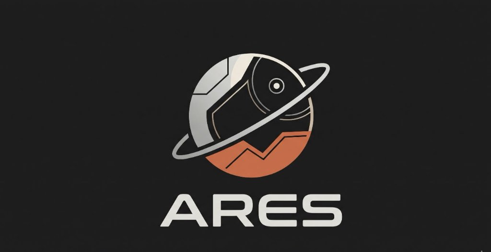

<p align="center">
  
</p>

<h1 align="center">A.R.E.S. — Autonomous Rover Exploration System</h1>
<h3 align="center">MARS-09 Mission Control · Autonomous Planetary Reconnaissance & Navigation</h3>

<p align="center">
  
  
  
  
  
  
</p>

---

## Overview

**A.R.E.S.** is a full-stack, production-grade autonomous planetary reconnaissance and rover navigation platform built for the **Innovision Hackathon (Track A — Planetary Reconnaissance & Autonomous Navigation)**.

The system addresses a fundamental challenge in deep-space exploration: the **4–24 minute one-way communication latency** between Earth and Mars makes real-time remote driving impossible. A.R.E.S. bridges this gap by providing an **autonomous on-board intelligence stack** capable of perception, planning, and execution without ground operator intervention.

```
┌─────────────────────────────────────────────────────────────────┐
│          MISSION CONTROL TACTICAL HUD  (React 18 + Vite)        │
│  ·  Three.js WebGL 3D Viewport         ·  2D Radar Minimap       │
│  ·  Continuous Spline Kinematics       ·  Artificial Horizon     │
│  ·  VisionScore 2.0 Dashboard          ·  Science Target Intel   │
└──────────────────────────────┬──────────────────────────────────┘
                               │  REST / JSON  (HTTP + GZip)
┌──────────────────────────────▼──────────────────────────────────┐
│            FASTAPI REST BACKEND BRIDGE  (Python 3.11+)           │
│  GET  /api/mission/telemetry           POST /api/navigation/compare│
│  GET  /api/science/targets             POST /api/visionscore/segment│
│  GET  /api/visionscore/camera/frame    POST /api/visionscore/alerts│
└──────────────────────────────┬──────────────────────────────────┘
                               │  Pure NumPy / SciPy Matrix Arrays
┌──────────────────────────────▼──────────────────────────────────┐
│          AUTONOMY & RECONNAISSANCE ENGINES  (Python)             │
│  ·  core.navigation — 8-dir A* Dual-Mode Pathfinder             │
│  ·  core.costmap    — Terrain Risk & Cost Map Generator          │
│  ·  terrain_intelligence — Full DEM Analysis Pipeline            │
│  ·  visionscore     — Semantic Segmentation & Obstacle Alerts    │
│  ·  backend.science — Geological Target Ranking Engine           │
└─────────────────────────────────────────────────────────────────┘
```

> **Data Notice:** All terrain, telemetry, and vision data produced by this platform is **synthetic and simulated**. It does not represent actual in-situ Mars telemetry or NASA reconnaissance measurements.

---

## Table of Contents

1. [Features](#features)  
2. [System Architecture](#system-architecture)  
3. [Module Reference](#module-reference)  
4. [VisionScore 2.0](#visionscore-20)  
5. [Navigation Engine](#navigation-engine)  
6. [Terrain Intelligence Pipeline](#terrain-intelligence-pipeline)  
7. [Frontend — Mission Control HUD](#frontend--mission-control-hud)  
8. [REST API Reference](#rest-api-reference)  
9. [Project Structure](#project-structure)  
10. [Installation & Quick Start](#installation--quick-start)  
11. [Test Suite](#test-suite)  
12. [Tech Stack](#tech-stack)  
13. [Team](#team)  

---

## Features

### 🛰️ Dual-Mode A* Autonomous Navigation
- **8-directional A\*** with admissible Euclidean heuristics — mathematically optimal on the discrete grid
- **Two simultaneous route strategies** computed in every planning call:
  - **Shortest Route** — minimises physical traversal distance
  - **Safest Route** — minimises accumulated terrain risk/cost with automatic detour reasoning
- Strict **diagonal corner-cutting prevention** stops the rover from squeezing through impassable hazard pinch points
- **Kinematic turn penalty** mode that adds chassis energy cost for heading changes
- **Multi-stop waypoint planning** — stitches sequential A* segments into a continuous mission route
- **Sub-100 ms dynamic rerouting** when new hazards are injected mid-traverse

### 🌋 Planetary Digital Elevation Modelling (DEM)
- **200×200 procedural geomorphological grid** — reproducible with a seed
- **5 Martian hazard systems** synthesised into the DEM:
  1. Volcanic calderas & magma fissures (cost = ∞)
  2. Aeolian sand traps & drift basins (caution, low traction)
  3. Landslide scarp boulder fields (instanced 3D boulders)
  4. Impact crater rim ejecta rings (concentric fracture fields)
  5. Roaming helical dust devils (dynamic atmospheric vortices)
- Terrain cost contract: `SAFE=1.0`, `CAUTION=5.0–20.0`, `HAZARD=∞`
- Slope-aware cost scaling (caution ≥ 12°, hazard ≥ 20°)

### 🔭 VisionScore 2.0 — Computer Vision Intelligence
- **Pixel-level semantic terrain segmentation** — SOIL, BEDROCK, SAND, BOULDER, UNKNOWN
- Real-time obstacle detection with event deduplication and **temporal cooldown**
- Annotated obstacle alert images saved with bounding-box overlays
- Semantic traversability classification: SAFE → CAUTION → HAZARD → UNKNOWN
- Candidate path safety evaluation against active visual obstacle alerts
- Support for **live camera stream** polling and **manual image upload** workflows
- Three-way view mode: original frame / segmentation mask / blended overlay

### 🧪 Science Intelligence Engine
- Geological target ranking across configurable science sites
- **Hard safety gating** — targets behind impassable hazards receive priority = 0
- Multi-factor scoring: mineralogical interest × navigational safety × energy expenditure × distance
- Automated mission recommendation reports per rover position

### 🖥️ 60+ FPS Mission Control Tactical HUD
- Full-screen **Three.js WebGL viewport** with real Martian topography mesh
- **Continuous Catmull-Rom spline kinematics** — no choppy grid hopping
- **6-wheel articulated rocker-bogie rover model** with procedural PBR materials
- Real-time 4-point surface normal alignment (pitch & roll) with quaternion `slerp` damping
- 3 camera perspectives: `ORBIT` · `ROVER CHASE` · `MASTCAM POV`
- Interactive hazard injection — click to spawn landslide / dust vortex / volcanic fissure
- Plotly-powered 2D topographic terrain heatmap view
- Artificial horizon inclinometer + 2D radar minimap

---

## System Architecture

### Three-Tier Decoupled Design

```
React Frontend  ←──── HTTP REST (JSON + GZip) ────→  FastAPI Backend  ←──→  Python Intelligence Engines
```

**Key design decisions:**
- Complete **separation of concerns** — the frontend never accesses terrain arrays directly
- All heavy computation (A*, DEM generation, segmentation) is confined to pure-Python engines
- The backend acts as a **thin adapter layer**, mapping REST schemas to engine contracts
- Frontend uses **React `useRef` mirrors** to allow 60+ FPS Three.js loops to read current state without React re-render overhead

### Bijective Spatial Coordinate Transformation

Navigation uses discrete grid `[row, col]` while Three.js uses continuous `(x, y, z)`:

$$x = \text{col} - \frac{\text{cols}-1}{2}, \quad z = \text{row} - \frac{\text{rows}-1}{2}$$
$$y = \left(\text{elevation}[\text{row}][\text{col}] - e_{\min}\right) \times s_{\text{elev}} + y_{\text{offset}}$$

**Bilinear DEM elevation interpolation** prevents the rover from ever floating or clipping through the terrain mesh during continuous motion:

$$e(r,c) = (1-f_r)(1-f_c)\,e_{00} + f_r(1-f_c)\,e_{10} + (1-f_r)f_c\,e_{01} + f_r f_c\,e_{11}$$

---

## Module Reference

### `core/` — Navigation & Cost Contracts

| File | Purpose |
|------|---------|
| `navigation.py` | 8-directional A\* pathfinder, dual-mode route comparison, path smoothing, dynamic rerouting |
| `costmap.py` | Cost map generator from slope + classification + obstacle mask |
| `config.py` | Global constants: grid size, slope thresholds, cost contract values |

#### `core/navigation.py` — Key Functions

| Function | Description |
|----------|-------------|
| `find_path(cost_map, start, goal, mode)` | Core A\* search returning structured path dict with smoothed trajectory |
| `compare_routes(cost_map, start, goal)` | Runs both modes and synthesises a telemetry trade-off report |
| `plan_mission_route(cost_map, start, waypoints)` | Multi-stop waypoint stitching |
| `recalculate_on_dynamic_hazard(...)` | Updates cost map with new hazards and replans from current position |
| `smooth_trajectory(path, cost_map)` | Gradient-descent path smoothing with hazard boundary clamping |
| `calculate_path_metrics(path, cost_map)` | Per-path telemetry: distance, cost, caution steps, max cell cost |

**Route Comparison Example (50×50 grid):**

| Metric | Shortest | Safest | Δ |
|--------|----------|--------|---|
| Total Distance | 280.8 m | 308.5 m | +9.8% |
| Accumulated Risk Cost | 1038.0 | 728.8 | **−29.8%** |
| Caution Steps | 210 | 152 | **−58 cells** |
| Recommendation | ❌ Rejected | ✅ Engaged | Detour justified |

---

### `terrain_intelligence/` — DEM Analysis Pipeline

| File | Purpose |
|------|---------|
| `terrain_generator.py` | Procedural Martian DEM (hills, craters, plains, rocky chaos regions) |
| `elevation_analyzer.py` | Elevation statistics, min/max/mean/std, relative relief |
| `slope_analyzer.py` | Per-cell slope angles in degrees via central-difference gradient |
| `obstacle_detector.py` | Rock/hazard mask generation from slope + roughness thresholds |
| `terrain_classifier.py` | Per-cell traversability classification (SAFE / CAUTION / HAZARD) |
| `cost_map_generator.py` | Assembles the navigation cost map from all analysis layers |
| `uncertainty_estimator.py` | Per-cell uncertainty score [0.0, 1.0] from classification ambiguity |
| `visualizer.py` | Matplotlib figures for overlay, heatmaps, and profile cross-sections |
| `pipeline.py` | End-to-end pipeline: generate → analyse → classify → cost → uncertainty |

**`TerrainIntelligenceResult` — Unified Output Container:**
```python
result.elevation_array       # 100×100 elevation (m)
result.slope_array_deg       # 100×100 slope angles (°)
result.obstacle_mask_array   # 100×100 boolean hazard mask
result.classification_array  # 100×100 int (0=SAFE, 1=CAUTION, 2=HAZARD)
result.movement_cost_array   # 100×100 float navigation costs
result.uncertainty_array     # 100×100 float [0.0, 1.0]
```

---

### `visionscore/` — Computer Vision Subsystem

| File | Purpose |
|------|---------|
| `config.py` | Environment profiles, semantic class taxonomy, colour palettes, traversability maps |
| `image_input.py` | Unified image input adapters: `ImageUploadSource`, `CameraFrameSource`, `SimulatedCameraFeed` |
| `analyzer.py` | Regional terrain analysis: `analyze_terrain()`, `AnalysisResult`, `TerrainSegment` |
| `semantic.py` | Pixel-level segmentation: `segment_terrain()`, `SemanticSegmentationResult`, colour overlays |
| `obstacle_detector.py` | `ObstacleEventDetector` — deduplication, cooldown, annotated alert images |
| `terrain_integration.py` | `evaluate_candidate_path_safety()`, `integrate_visual_obstacle()` |
| `results.py` | `VisualResults` serialisation interface |

#### Semantic Class Taxonomy (AI4Mars-compatible)

| Label ID | Class | Colour | Traversability |
|----------|-------|--------|---------------|
| 0 | **SOIL** | `#B85032` | SAFE — Nominal |
| 1 | **BEDROCK** | `#6B7280` | SAFE — High traction |
| 2 | **SAND** | `#EDC989` | CAUTION — Slip risk |
| 3 | **BOULDER** | `#4B5563` | HAZARD — Collision risk |
| 255 | **UNKNOWN** | `#6C3483` | UNCERTAIN |
| — | REGOLITH | — | Planned model |
| — | CRATER | — | Planned model |
| — | DUST | — | Planned model |

#### `ObstacleAlert` Schema

```python
@dataclass
class ObstacleAlert:
    event_id: str              # e.g. "EVT-20261114-025146-2fb7d605"
    timestamp: str             # ISO 8601 UTC
    source: str                # "CAMERA" | "UPLOAD"
    detection_category: str    # "HAZARD_OBSTACLE" | "BOULDER_CLUSTER" | ...
    confidence: float          # [0.0, 1.0]
    obstacle_area_pct: float   # % of frame
    bounding_box: tuple        # (min_row, min_col, max_row, max_col)
    verification_status: str   # "UNVERIFIED" | "CONFIRMED" | "FALSE_POSITIVE" | "BYPASSED"
    captured_image: np.ndarray # Clean RGB frame
    annotated_image: np.ndarray# Annotated diagnostic overlay
    explanation: str           # Human-readable risk rationale
```

---

### `backend/` — FastAPI REST Bridge

| File | Purpose |
|------|---------|
| `main.py` | App factory, CORS, GZip middleware, router registration |
| `schemas.py` | Pydantic request/response models for all endpoints |
| `api/navigation.py` | Navigation comparison & terrain fetch endpoints |
| `api/science.py` | Science target ranking and mission report endpoints |
| `api/mission.py` | Mission telemetry, rover status endpoints |
| `api/visionscore.py` | VisionScore 2.0 segmentation, alerts, camera stream, path evaluation |
| `integrations/terrain_adapter.py` | Terrain engine adapter — caches default terrain for the session |
| `integrations/navigation_adapter.py` | Navigation engine adapter |
| `science/scoring.py` | Multi-factor science target evaluation and ranking |
| `science/recommendations.py` | Natural-language mission recommendation report generator |
| `science/identification.py` | Geological target identification logic |
| `science/uncertainty.py` | Science confidence and uncertainty estimation |

---

## VisionScore 2.0

VisionScore is the **onboard optical reconnaissance subsystem** providing semantic terrain perception without deep-learning model weights (a deterministic optical/texture feature segmenter, explicitly labelled as a demo algorithmic model).

### Key Capabilities

```
Image Input (Upload / Camera)
        │
        ▼
ImageInputHandler ── validates, normalises, metadata tags
        │
        ▼
segment_terrain() ── DemoSemanticSegmentationModel
        │
        ├─→ segmentation_mask (H × W int)
        ├─→ color_map (H × W × 3 uint8)
        ├─→ overlay_image (H × W × 3 uint8)
        ├─→ class_pixel_percentages {SOIL: 42.3%, SAND: 18.1%, ...}
        ├─→ traversability_summary {SAFE: 60.4%, CAUTION: 18.1%, HAZARD: 12.3%, UNKNOWN: 9.2%}
        ├─→ region_segments [{class, bbox, area_pct, centroid}, ...]
        └─→ confidence_information {mean_confidence, per_class, uncertainty}
        │
        ▼
ObstacleEventDetector ── dedup + cooldown
        │
        ├─→ ObstacleAlert {event_id, confidence, bounding_box, images}
        └─→ outputs/obstacle_alerts/ (annotated PNG pairs)
        │
        ▼
evaluate_candidate_path_safety() ── cross-checks navigation path against active alerts
```

### Dashboard Controls

| Control | Function |
|---------|----------|
| **Environment Selector** | Switch between MARS / SIMULATION_MARS profiles |
| **Terrain Mode** | Focus segmentation on MIXED / SOIL / BEDROCK / SAND / BOULDER |
| **View Mode** | Toggle overlay / segmentation mask / original frame / side-by-side |
| **Obstacle Inject** | Trigger a synthetic obstacle event into the camera stream |
| **Terrain Filter** | Filter event history by semantic class |
| **Status Filter** | Filter alerts by UNVERIFIED / CONFIRMED / FALSE_POSITIVE |
| **Image Upload** | Analyse a custom image through the full VisionScore pipeline |
| **Live Streaming** | Poll camera feed every 3 seconds for continuous automatic detection |

---

## Navigation Engine

### A\* Algorithm Details

The A\* planner operates on an 8-connected 2D grid with admissible Euclidean heuristics.

**Step costs:**

$$\text{cost\_step}_{\text{safest}} = \ell \times c_{\text{cell}}, \qquad \text{cost\_step}_{\text{shortest}} = \ell$$

where $\ell = 1.0$ (orthogonal) or $\ell = \sqrt{2}$ (diagonal), and $c_{\text{cell}}$ is the terrain cost.

**Heuristic admissibility guarantee:**

$$h(n) = d(n, \text{goal}) \times c_{\min} \leq g^*(n, \text{goal})$$

**Diagonal corner-cutting prevention:** When moving diagonally, both orthogonal neighbours must be traversable — the rover cannot squeeze through a crack between two impassable cells.

**Trajectory Smoothing** (gradient descent):

$$p_i^{(t+1)} = p_i^{(t)} + w_d(p_i^{(0)} - p_i^{(t)}) + w_s(p_{i-1}^{(t)} + p_{i+1}^{(t)} - 2p_i^{(t)})$$

where $w_d = 0.5$ (data fidelity) and $w_s = 0.1$ (smoothing). Endpoints are fixed and intermediate points are clamped away from hazard cells.

---

## Terrain Intelligence Pipeline

```
TerrainGenerator.generate()
    │  ↳ Gaussian hills + crater depressions + flat plains + rocky chaos
    │  ↳ 100×100 elevation array in metres
    ▼
ElevationAnalyzer.analyze()     → min, max, mean, std, relative relief
    ▼
SlopeAnalyzer.compute()         → per-cell slope in degrees (central difference)
    ▼
ObstacleDetector.detect()       → boolean obstacle mask (slope + roughness)
    ▼
TerrainClassifier.classify()    → 0=SAFE / 1=CAUTION / 2=HAZARD per cell
    ▼
CostMapGenerator.generate()     → float cost array (1.0 / 5–20 / inf)
    ▼
UncertaintyEstimator.estimate() → uncertainty score [0.0, 1.0] per cell
    ▼
TerrainIntelligenceResult       → unified output for navigation & visionscore
```

**Cost Map Contract (strict):**

| Class | Cost | Condition |
|-------|------|-----------|
| SAFE | `1.0` | Slope < 12°, no obstacle |
| CAUTION | `5.0 – 20.0` | Slope 12°–20°, scaled by slope + rock density |
| HAZARD | `∞` | Slope ≥ 20° OR discrete obstacle |

---

## Frontend — Mission Control HUD

### Component Architecture

```
App.jsx
├── TerrainThreeMap.jsx         ← Three.js WebGL 3D viewport (1200+ lines)
│   ├── MarsRoverModel.js       ← 6-wheel procedural PBR rover model
│   ├── OrbitControls            ← Camera orbit / pan / zoom
│   ├── Particle systems        ← Volcanic embers + wind dust + dust devils
│   └── Route ribbons           ← Red (shortest) + green (safest) path lines
├── InteractiveRoverHUD.jsx     ← Mission control control strip
│   ├── ArtificialHorizon.jsx   ← Real-time pitch / roll inclinometer
│   ├── RadarMinimap.jsx        ← 2D canvas minimap with camera frustum
│   ├── ElevationProfileChart.jsx ← Plotly elevation cross-section
│   ├── SimulationControls.jsx  ← Play / Pause / Speed / Route selector
│   └── RoverTelemetry.jsx      ← Environmental telemetry strip
├── Terrain3DMap.jsx            ← Plotly 2D topographic terrain heatmap
├── RouteMetrics.jsx            ← Dual-route telemetry comparison table
├── VisionScoreDashboard.jsx    ← Full VisionScore 2.0 UI (950 lines)
├── ScienceTargets.jsx          ← Geological target ranking table
└── NavigationMap.jsx           ← Plotly route overlay heatmap
```

### Three.js Rover Physics

- **Catmull-Rom spline traversal** — waypoints compiled into a continuous `THREE.CatmullRomCurve3`
- **Velocity modulation** based on terrain gradient:

$$v = v_{\text{base}} \times (1 - 0.45 \times f_{\text{uphill}}) \times f_{\text{traction}}$$

- **4-point surface normal alignment** — samples elevation at front/rear/left/right chassis corners to calculate live pitch and roll, damped via quaternion `slerp`
- **Wheel roll animation** proportional to forward velocity
- **Steering bogie articulation** — front/rear wheels counter-steer based on spline curvature

### Camera Modes

| Mode | Description |
|------|-------------|
| `ORBIT` | Free examination via mouse orbit/pan/zoom; click terrain to place start/goal pins or inject hazards |
| `ROVER_CHASE` | Smooth 3rd-person damped camera tracking rover from behind and above |
| `MASTCAM_POV` | First-person optical perspective from rover mast sensor position |

### Hazard Injection

Operators can inject dynamic hazards in real time:
1. Select `LANDSLIDE` / `DUST VORTEX` / `ERUPT FISSURE` tool mode
2. Click directly on the 3D terrain mesh
3. Raycaster converts click to grid coordinates and sets `cost_map[r,c] = ∞`
4. Navigation replans from current rover position within **sub-100 ms**
5. Rover splices the new path seamlessly without stopping animation

---

## REST API Reference

**Base URL:** `http://127.0.0.1:8000`  
**Interactive Docs:** `http://127.0.0.1:8000/docs`

### Navigation

| Method | Endpoint | Description |
|--------|----------|-------------|
| `POST` | `/api/navigation/compare` | Compute shortest + safest routes with trade-off summary |
| `GET` | `/api/navigation/terrain` | Fetch current terrain cost map and DEM data |

**`POST /api/navigation/compare` Payload:**
```json
{
  "start": [15, 15],
  "goal": [185, 185],
  "turn_penalty": 0.0
}
```

**Response schema:**
```json
{
  "shortest": { "route": {...}, "metrics": {"total_distance": 280.8, "total_cost": 1038.0, "caution_steps": 210} },
  "safest":   { "route": {...}, "metrics": {"total_distance": 308.5, "total_cost": 728.8, "caution_steps": 152} },
  "summary":  {
    "both_reachable": true,
    "distance_delta": 27.66,
    "distance_penalty_pct": 9.8,
    "cost_reduction_pct": 29.8,
    "caution_steps_avoided": 58,
    "recommendation": "MARS-09 recommends the SAFEST route. ..."
  }
}
```

### Science Intelligence

| Method | Endpoint | Description |
|--------|----------|-------------|
| `GET` | `/api/science/targets` | Evaluate and rank all geological targets from current rover position |
| `GET` | `/api/science/targets/{id}` | Detailed assessment for a specific science target |
| `GET` | `/api/science/report` | Full mission science recommendation report |

### Mission Telemetry

| Method | Endpoint | Description |
|--------|----------|-------------|
| `GET` | `/api/mission/telemetry` | Live rover telemetry, environmental data, system status |

### VisionScore 2.0

| Method | Endpoint | Description |
|--------|----------|-------------|
| `GET` | `/api/visionscore/status` | Subsystem status, feature inventory, alert count |
| `POST` | `/api/visionscore/segment` | Full semantic segmentation of an uploaded image |
| `GET` | `/api/visionscore/alerts` | Retrieve obstacle alert history with optional filters |
| `GET` | `/api/visionscore/camera/frame` | Latest simulated camera frame with segmentation |
| `POST` | `/api/visionscore/camera/trigger` | Trigger a synthetic obstacle injection event |
| `POST` | `/api/visionscore/evaluate-path` | Cross-check a planned path against active visual alerts |

**`POST /api/visionscore/segment` Payload:**
```
Content-Type: multipart/form-data
  file: <image file>
  environment: "MARS"
  terrain_mode: "MIXED"
```

---

## Project Structure

```
HackInnovision/
├── backend/                        # FastAPI REST bridge
│   ├── main.py                     # App factory + middleware + router registration
│   ├── schemas.py                  # Pydantic request/response schemas
│   ├── api/
│   │   ├── navigation.py           # Navigation API endpoints
│   │   ├── science.py              # Science intelligence endpoints
│   │   ├── mission.py              # Mission telemetry endpoints
│   │   └── visionscore.py          # VisionScore 2.0 endpoints
│   ├── integrations/
│   │   ├── terrain_adapter.py      # Terrain engine session cache
│   │   └── navigation_adapter.py   # Navigation engine adapter
│   └── science/
│       ├── scoring.py              # Target scoring & ranking
│       ├── recommendations.py      # Natural-language report generator
│       ├── identification.py       # Geological identification
│       └── uncertainty.py          # Science confidence estimation
│
├── core/                           # Navigation & cost contracts
│   ├── navigation.py               # 8-dir A*, path smoothing, route comparison
│   ├── costmap.py                  # Cost map generator
│   └── config.py                   # Global constants
│
├── terrain_intelligence/           # DEM analysis pipeline
│   ├── pipeline.py                 # End-to-end pipeline orchestrator
│   ├── terrain_generator.py        # Procedural Martian DEM
│   ├── elevation_analyzer.py       # Elevation statistics
│   ├── slope_analyzer.py           # Slope computation
│   ├── obstacle_detector.py        # Obstacle mask generation
│   ├── terrain_classifier.py       # SAFE/CAUTION/HAZARD classification
│   ├── cost_map_generator.py       # Navigation cost assembly
│   ├── uncertainty_estimator.py    # Per-cell uncertainty scores
│   ├── visualizer.py               # Matplotlib terrain visualisations
│   └── config.py                   # Pipeline configuration
│
├── visionscore/                    # Computer vision subsystem
│   ├── __init__.py                 # Public API surface (all exports)
│   ├── config.py                   # Semantic taxonomy, colour palettes, profiles
│   ├── image_input.py              # Image input adapters + camera streams
│   ├── analyzer.py                 # Regional terrain analysis
│   ├── semantic.py                 # Pixel-level semantic segmentation
│   ├── obstacle_detector.py        # Obstacle event detection + alerts
│   ├── terrain_integration.py      # Path safety evaluation
│   └── results.py                  # Result serialisation
│
├── frontend/                       # React 18 + Vite Mission Control HUD
│   ├── index.html                  # HTML entry point
│   ├── package.json                # Node.js dependencies
│   ├── public/
│   │   ├── image_57d289.png        # ARES transparent logo (RGBA)
│   │   └── assets/
│   └── src/
│       ├── App.jsx                 # Root component + global state
│       ├── api/client.js           # Axios REST client helpers
│       ├── hooks/useMissionData.js # Data-fetching hook
│       ├── utils/coordinateMapping.js  # Grid↔Three.js bijective transform
│       └── components/
│           ├── three/
│           │   ├── TerrainThreeMap.jsx   # Three.js WebGL viewport (~1200 lines)
│           │   └── MarsRoverModel.js     # Procedural PBR rover + physics
│           ├── navigation/
│           │   ├── InteractiveRoverHUD.jsx
│           │   ├── ArtificialHorizon.jsx
│           │   ├── RadarMinimap.jsx
│           │   ├── ElevationProfileChart.jsx
│           │   ├── SimulationControls.jsx
│           │   └── RoverTelemetry.jsx
│           ├── terrain/
│           │   ├── Terrain3DMap.jsx
│           │   ├── TerrainControls.jsx
│           │   ├── RoverMarker.jsx
│           │   └── HazardOverlay.jsx
│           ├── visionscore/
│           │   └── VisionScoreDashboard.jsx  # Full VS2.0 UI (~950 lines)
│           ├── NavigationMap.jsx     # Plotly route heatmap
│           ├── RouteMetrics.jsx      # Dual-route telemetry table
│           ├── ScienceTargets.jsx    # Science target ranking UI
│           ├── MissionOverview.jsx   # Mission status panel
│           └── shared/              # ErrorBoundary, StatusChip, EmptyState
│
├── tests/                          # Automated test suite (108 tests)
│   ├── test_navigation.py          # A* algorithm, corner-cutting, heuristic admissibility
│   ├── test_navigation_contract.py # JSON schema & payload contract stability
│   ├── test_ai4mars_dataset.py     # AI4Mars label mapping validation
│   ├── test_visionscore_stage1.py  # VisionScore config, profiles, taxonomy
│   ├── test_visionscore_stage2.py  # Segmentation, overlays, region detection
│   ├── test_visionscore_task1.py   # Obstacle detection & alert generation
│   ├── test_cost_map_generator.py  # Cost map contract verification
│   ├── test_slope_analyzer.py      # Slope computation accuracy
│   ├── test_elevation_analyzer.py  # Elevation statistics
│   ├── test_obstacle_detector.py   # Obstacle mask generation
│   ├── test_terrain_classifier.py  # Traversability classification
│   ├── test_terrain_generator.py   # DEM generation reproducibility
│   ├── test_uncertainty_estimator.py # Uncertainty score bounds
│   ├── test_pipeline.py            # End-to-end pipeline integration
│   ├── test_integration.py         # Cross-module integration
│   ├── test_science_and_backend.py # Science scoring & recommendation
│   └── test_visualizer.py          # Visualiser output validation
│
├── data/
│   └── sample/targets_catalog.json # Geological science target definitions
├── outputs/
│   ├── obstacle_alerts/            # Saved obstacle event images (annotated pairs)
│   └── visionscore/                # VisionScore output frames & reports
├── requirements.txt                # Python dependencies
├── pyproject.toml                  # Build system + pytest configuration
└── main.py                         # CLI entry point for standalone demos
```

---

## Installation & Quick Start

### Prerequisites

- **Python 3.11+**
- **Node.js 18+** and **npm 9+**
- Windows / macOS / Linux

### 1. Clone the Repository

```bash
git clone https://github.com/Rudra4451/hackinnovision.git
cd hackinnovision
```

### 2. Install Python Dependencies

```bash
pip install -r requirements.txt
```

### 3. Start the Backend

```bash
python -m uvicorn backend.main:app --host 127.0.0.1 --port 8000 --reload
```

The FastAPI server will start at `http://127.0.0.1:8000`.  
Interactive API docs are at `http://127.0.0.1:8000/docs`.

### 4. Install & Start the Frontend

```bash
npm install --prefix frontend
npm run dev --prefix frontend
```

The Mission Control HUD will open at `http://127.0.0.1:5173`.

### 5. Build for Production

```bash
npm run build --prefix frontend
```

Output is written to `frontend/dist/`.

---

## Test Suite

The project includes **108 automated unit and integration tests** covering every major subsystem.

```bash
# Run all tests
python -m pytest tests/ -v

# Run only navigation tests
python -m pytest tests/test_navigation.py -v

# Run only VisionScore tests
python -m pytest tests/test_visionscore_stage1.py tests/test_visionscore_stage2.py tests/test_visionscore_task1.py -v

# Run with coverage summary
python -m pytest tests/ --tb=short -q
```

**Test results:** `108 passed` ✅

| Test File | Scope | Tests |
|-----------|-------|-------|
| `test_navigation.py` | A\* algorithm, corner-cutting, heuristic, smoothing | 11 |
| `test_navigation_contract.py` | JSON schema stability | 8 |
| `test_ai4mars_dataset.py` | AI4Mars label mapping, IGNORE handling | 11 |
| `test_visionscore_stage1.py` | Config, profiles, semantic taxonomy | 12 |
| `test_visionscore_stage2.py` | Segmentation, overlays, region segments | 13 |
| `test_visionscore_task1.py` | Obstacle detection, alert generation | 13 |
| `test_cost_map_generator.py` | Cost contract verification | 4 |
| `test_slope_analyzer.py` | Slope accuracy | 4 |
| `test_elevation_analyzer.py` | Elevation statistics | 4 |
| `test_obstacle_detector.py` | Obstacle mask generation | 4 |
| `test_terrain_classifier.py` | Traversability classification | 3 |
| `test_terrain_generator.py` | DEM reproducibility & shape | 5 |
| `test_uncertainty_estimator.py` | Uncertainty bounds [0, 1] | 4 |
| `test_pipeline.py` | End-to-end pipeline | 2 |
| `test_integration.py` | Cross-module integration | 2 |
| `test_science_and_backend.py` | Science scoring & recommendations | 7 |
| `test_visualizer.py` | Visualiser output | 1 |

---

## Tech Stack

### Backend
| Library | Version | Role |
|---------|---------|------|
| Python | 3.11+ | Runtime |
| FastAPI | ≥ 0.110 | REST API framework |
| Uvicorn | ≥ 0.28 | ASGI server |
| Pydantic | ≥ 2.6 | Schema validation |
| NumPy | ≥ 1.26 | Terrain arrays & cost maps |
| SciPy | ≥ 1.10 | Gaussian filters, ndimage, interpolation |
| Pandas | ≥ 2.2 | Science target data |
| Pillow | ≥ 10.0 | Image processing, overlay generation |
| Matplotlib | ≥ 3.7 | Terrain visualisation figures |
| Plotly | ≥ 5.15 | Interactive chart serialisation |
| httpx / requests | ≥ 0.27 | HTTP client |
| pytest | ≥ 8.0 | Test framework |
| python-multipart | ≥ 0.0.9 | File upload handling |

### Frontend
| Library | Version | Role |
|---------|---------|------|
| React | 18.3 | UI framework |
| Vite | 6.1 | Build tool & dev server |
| Three.js | r187 | WebGL 3D viewport |
| Plotly.js | 3.0 | Interactive 2D charts |
| Axios | 1.7 | REST API client |
| Lucide React | 0.475 | Icon library |
| Tailwind CSS | — | Utility-first styling |

---

## Team

Built for the **Innovision Hackathon — Track A: Planetary Reconnaissance & Autonomous Navigation**

| Member | Role |
|--------|------|
| Member 1 | Navigation & Path Planning (A\*, Route Comparison) |
| Member 2 | Terrain Intelligence (DEM Pipeline, Cost Maps, Analysis) |
| Member 3 | Backend Bridge & Science Intelligence Engine |
| Member 4 | Frontend, Three.js HUD, Branding (A.R.E.S.) |

**Repository:** [github.com/Rudra4451/hackinnovision](https://github.com/Rudra4451/hackinnovision)

---

## License

MIT License — see [LICENSE](LICENSE) for details.

---

<p align="center">
  <i>"A.R.E.S. bridges the gap between deep-space algorithmic intelligence and mission-control ergonomics.<br>
  By unifying cost-aware A* pathfinding, continuous 60 FPS 3D kinematics, dynamic hazard rerouting,<br>
  and optical hazard classification into a single responsive platform, it proves that autonomous<br>
  planetary exploration can be both mathematically sound and visually transparent."</i>
</p>
